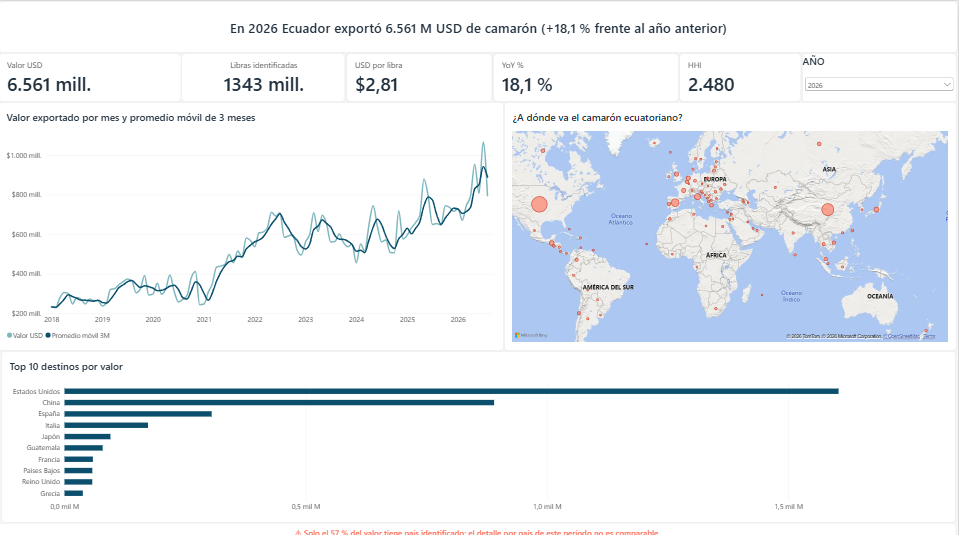
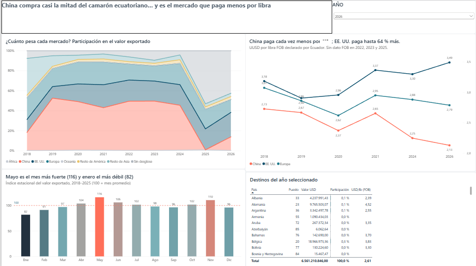
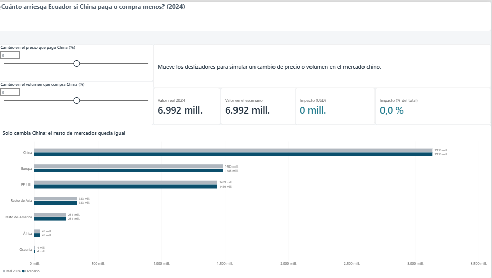
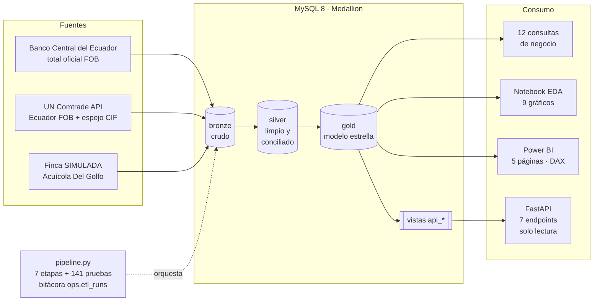

# 🦐 Shrimp Intelligence Ecuador

**Pipeline de datos, API y dashboard sobre las exportaciones de camarón del Ecuador (2018–2026)**: de fuentes públicas que no coinciden a cifras conciliadas, hallazgos de negocio y un simulador de riesgo.


> **English summary.** End-to-end data project on Ecuador's shrimp exports (USD 8.4 B in 2025, the country's top non-oil export). It extracts official Central Bank totals and UN Comtrade detail (including mirror statistics), builds a Medallion pipeline in MySQL (bronze → silver → gold star schema) with 141 automated tests, and serves the data through a read-only FastAPI service and a 5-page Power BI report with a what-if risk simulator. Key findings: China buys 42–52 % of the value but pays the lowest price per pound, and the gap with the US widened from +9 % to +64 %; a 10 % price drop in China would cost Ecuador USD 314 M (2024). A simulated shrimp farm demonstrates the same method at the operational level.

---

## El problema

El camarón es la **primera exportación no petrolera del Ecuador**: **8.401 M USD en 2025**, 2,6 veces lo de 2018. Pero sus datos están dispersos y **no coinciden**:

- el **Banco Central (BCE)** publica el total oficial, pero no el detalle por país;
- **UN Comtrade** tiene el detalle por país, en dos versiones: lo que declara Ecuador (FOB) y lo que declaran los compradores (espejo, CIF), que difieren hasta ±50 % por mes;
- en **2025 China no reportó** sus importaciones, y más de la mitad del valor quedó sin país identificado.

**Pregunta del proyecto:** ¿quién compra el camarón ecuatoriano, a qué precio, con qué riesgo, y qué tan confiables son las cifras para decidir?

## Hallazgos principales

| # | Hallazgo | Dato |
|---|---|---|
| 1 | **Ecuador depende de un solo comprador** | China = 42–52 % del valor (2019–2024); HHI > 2.500 todos los años comparables (máx. 3.521). Si China pagara 10 % menos: **−314 M USD** (−4,5 % de 2024) |
| 2 | **El mayor comprador es el que paga menos** | China: 2,73 → 2,13 USD/lb; EE. UU. paga **+47 %** (2024) y **+64 %** (2026) |
| 3 | **Se creció por volumen, no por precio** | 2018–2020: **+39 %** de libras, **−11 %** de precio |
| 4 | **Estacionalidad moderada** | Enero 82, mayo 116 (100 = mes promedio) |
| 5 | **La talla de cosecha decide el margen** *(SIMULADO)* | 20/30: 54,6 % frente a 50/60: 27,8 %; margen vs precio r = 0,90, vs FCR r = −0,14 |
| 6 | **Cada fuente sirve para una pregunta distinta** | Ecuador vs BCE: −7,7 % → −1,1 %; espejo mensual hasta ±50 %; solo 9 de 38 países coinciden |

➡️ Detalle, recomendaciones, modelos futuros y lecciones para el sector: **[docs/insights.md](docs/insights.md)**

## Dashboard (Power BI)

Cinco páginas: **Resumen**, **Mercados**, **Simulador de escenarios**, **Finca (SIMULADO)** y **Conciliación de fuentes**. Ver todas en el [PDF del dashboard](docs/powerbi/shrimp_intelligence_dashboard.pdf) y la [guía de diseño](docs/powerbi_guia.md).



| Mercados | Simulador de escenarios |
|---|---|
|  |  |

## Arquitectura



## Stack y decisiones

| Capa | Tecnología | Decisión documentada |
|---|---|---|
| Almacenamiento | MySQL 8 · Medallion (bronze, silver, gold) | [ADR-001](docs/adr/ADR-001-medallion-mysql.md) |
| Modelado | Silver en 3FN; gold en modelo estrella (2 hechos, 6 dimensiones) | [ADR-002](docs/adr/ADR-002-3fn-silver-estrella-gold.md), [ADR-007](docs/adr/ADR-007-modelo-estrella-gold.md) |
| ETL | Python 3.14, pandas, SQLAlchemy · batch incremental, idempotente | [ADR-003](docs/adr/ADR-003-etl-batch-incremental.md) |
| Fuentes | Total = BCE; detalle = Ecuador (FOB) y espejo solo donde falta | [ADR-006](docs/adr/ADR-006-estrategia-fuentes.md) |
| Servicio | FastAPI sobre vistas `gold.api_*`, usuario de solo lectura | [ADR-004](docs/adr/ADR-004-fastapi-capa-de-servicio.md) |
| Análisis | SQL con window functions · notebook con matplotlib | [hallazgos SQL](docs/hallazgos_sql.md) · [notebook](notebooks/README.md) |
| Visualización | Power BI (`.pbip`, modo Import, usuario de solo lectura) | [guía del dashboard](docs/powerbi_guia.md) |
| Calidad | pytest (unitarias + pruebas de datos), reporte de calidad | [reporte de calidad](docs/data_quality_report.md) |

## Qué es real y qué es simulado

| Real (fuentes públicas) | Simulado |
|---|---|
| Exportaciones totales del BCE (enero 2018–agosto 2026) | La finca **"Acuícola Del Golfo"**: 3 sedes, 45 piscinas, 510 ciclos (2023–2026) |
| Detalle por país, valor y peso de UN Comtrade (Ecuador y espejo) | Sus costos, tallas, FCR, supervivencia y precios de venta |
| Todos los hallazgos 1–4 y 6 | El hallazgo 5 (el **método** es real; las cifras no describen a ninguna empresa) |

## Calidad: cómo sé que las cifras son correctas

- **El total preferido cuadra con el BCE en los 104 meses** (prueba automática en `tests/test_gold_data.py`).
- **141 pruebas**: reglas de limpieza, integridad de silver y gold, bitácora del pipeline y API (incluida una que verifica que el usuario de la API **no puede** leer silver ni borrar datos).
- **Tres capas dan la misma cifra:** SQL, API y Power BI (validación documentada en la página oculta *Validación*).
- **Validación externa:** la prensa publica, citando al BCE, 8.401 M USD en 2025 (+20,2 %) y 6.560 M USD de enero a agosto de 2026 (+18 %); el proyecto da lo mismo.
- **Conciliación visible:** las diferencias entre fuentes se miden y se muestran, no se esconden ([página Conciliación](docs/img/powerbi/05_conciliacion.png)).

## Cómo ejecutarlo

Requisitos: Windows o Linux, Python 3.14, MySQL 8, y una llave gratuita de [UN Comtrade](https://comtradedeveloper.un.org/) (solo para extraer datos nuevos).

```powershell
# 1. Entorno
git clone https://github.com/CarlosRomero55/shrimp-intelligence-ecuador.git
cd shrimp-intelligence-ecuador
python -m venv .venv
.\.venv\Scripts\Activate.ps1
pip install -r requirements.txt

# 2. Configuración: copiar .env.example a .env y completar los valores (nunca se sube a GitHub)
copy .env.example .env

# 3. Esquemas en MySQL (como root): sql/00_ops.sql … sql/04_api_views.sql

# 4. Pipeline completo (silver → conciliación → gold → reporte de calidad → pruebas)
python -m src.pipeline              # agrega --extract para traer meses nuevos de UN Comtrade

# 5. Consultas de negocio, API y pruebas
python -m src.run_queries
uvicorn src.api.main:app --reload   # documentación en http://127.0.0.1:8000/docs
python -m pytest -q
```

Guías detalladas: [cómo ejecutar](docs/como_ejecutar.md) · [descarga del BCE](docs/fuentes/bce_descarga_manual.md) · [API](docs/api.md) · [dashboard](docs/powerbi_guia.md).

## Estructura del repositorio

```
shrimp-intelligence-ecuador/
├── sql/                 # Esquemas (00_ops … 04_api_views) y consultas de negocio (queries/q01–q12)
├── src/                 # Extracción, limpieza, conciliación, gold, pipeline, calidad
│   └── api/             # FastAPI: conexión de solo lectura y endpoints
├── tests/               # 141 pruebas (unitarias y de datos con la marca "db")
├── notebooks/           # EDA: 9 gráficos con conclusión
├── powerbi/             # Proyecto de Power BI (.pbip) y tema de colores
├── examples/            # Cliente de ejemplo de la API
└── docs/
    ├── adr/             # Decisiones de arquitectura
    ├── img/             # Gráficos del EDA y capturas del dashboard
    ├── insights.md      # Hallazgos, recomendaciones y trabajo futuro
    └── …                # API, calidad, cómo ejecutar, guía de Power BI
```

## Limitaciones

- 2025–2026: más de la mitad del valor sin país (China no reportó); esos años no se comparan por país.
- El precio por mercado solo existe en años con dato de Ecuador (FOB): 2018–2021, 2024 y 2026 (3 meses).
- Las partidas HS 030617 y 1605 no separan el tipo de producto (entero, pelado, cocido).
- No se cargaron datos de la Cámara Nacional de Acuacultura.
- Precios nominales (sin ajuste por inflación).
- La finca es simulada y en la simulación el FCR casi no varía.

## Próximos pasos

- **Pronóstico** de exportaciones mensuales (SARIMA o Prophet) y **simulación Monte Carlo** del riesgo de concentración.
- **Datos por tipo de producto** (SENAE) para probar por qué China paga menos.
- **Modelo de decisión de cosecha** con datos reales de una finca y sensores (FCR, oxígeno, talla).
- Llevar el pipeline y el dashboard a la **nube** (por ejemplo, Microsoft Fabric) con actualización programada.

## Autor

**Carlos Romero** · Ingeniero en Tecnologías de la Información · Business Intelligence, Ciencia de Datos y Automatización · Guayaquil, Ecuador

[LinkedIn](https://www.linkedin.com/in/TU-PERFIL) · [GitHub](https://github.com/CarlosRomero55)

---

<sub>Fuentes: Banco Central del Ecuador (cuadro 3.1.2) y UN Comtrade. Los datos de UN Comtrade se usan con fines analíticos y educativos. La finca "Acuícola Del Golfo" es ficticia. Este proyecto no es asesoría financiera ni comercial.</sub>
