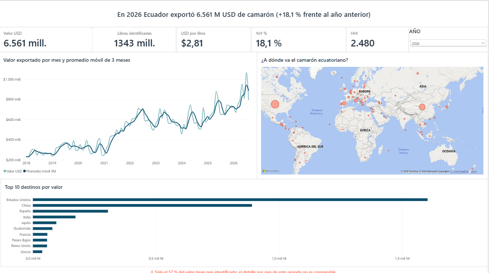
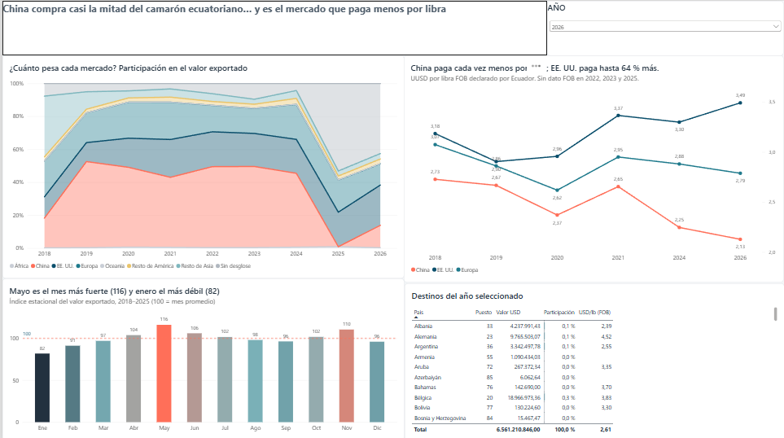
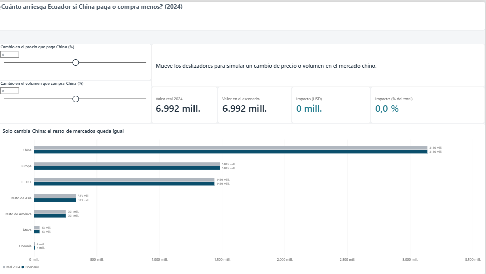
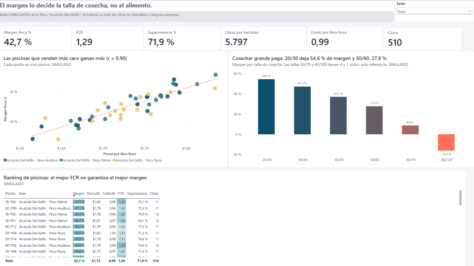
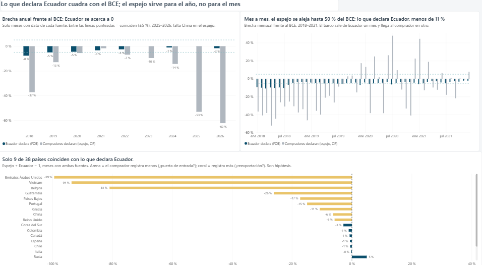

# Dashboard de Power BI — Shrimp Intelligence Ecuador

Reporte de 5 páginas sobre la capa **gold** (modelo estrella en MySQL). Proyecto en `powerbi/shrimp_intelligence.pbip`.

| Página | Pregunta que responde | Captura |
|---|---|---|
| 1. Resumen | ¿Cuánto se exportó, a qué precio y qué tan concentrado está el mercado? | `docs/img/powerbi/01_resumen.png` |
| 2. Mercados | ¿Quién compra, cuánto paga por libra y en qué meses? | `docs/img/powerbi/02_mercados.png` |
| 3. Simulador | ¿Cuánto arriesga Ecuador si China paga o compra menos? | `docs/img/powerbi/03_simulador.png` |
| 4. Finca (SIMULADO) | ¿Qué piscinas ganan más y por qué? | `docs/img/powerbi/04_finca.png` |
| 5. Conciliación | ¿Qué tan confiables son las fuentes? | `docs/img/powerbi/05_conciliacion.png` |







## 1. Cómo abrirlo

1. Requisitos: Power BI Desktop, **MySQL Connector/NET** (el conector "Base de datos MySQL" lo necesita; si la versión 9.x no se detecta, usar una 8.x) y MySQL con gold cargado (`python -m src.pipeline`).
2. Abrir `powerbi/shrimp_intelligence.pbip`.
3. Al actualizar, Power BI pide credenciales: **Base de datos** → usuario `bi_reader` (ver sección 2). Las credenciales quedan en el perfil de Windows, nunca en el proyecto.
4. **Inicio → Actualizar** trae los datos de gold.

## 2. Decisiones de diseño

| Decisión | Elegido | Por qué |
|---|---|---|
| Conexión | MySQL directo | El modelo estrella completo con sus relaciones; la API (Fase 11) queda como alternativa sin instalar nada. |
| Tablas | Estrella de gold: 2 hechos + 6 dimensiones | Los cálculos (YoY, HHI, escenarios) se hacen en DAX; las vistas `api_*` traen todo precalculado. |
| Almacenamiento | Import | ~10 mil filas: rápido, DAX completo y licencia gratuita. |
| Usuario | `bi_reader` con `SELECT, SHOW VIEW ON gold.*` | Mínimo privilegio: no ve bronze, silver ni ops, ni puede escribir. |
| Formato | `.pbip` (proyecto) | Modelo y medidas en texto (TMDL): GitHub muestra qué cambió. `.pbi/cache.abf` (copia de los datos) y `localSettings.json` van en `.gitignore`. |
| Fechas | `dim_date` marcada como tabla de fechas; "Fecha y hora automáticas" desactivado | Una sola tabla de fechas; sin 7 tablas ocultas automáticas. |

### Modelo

- 8 relaciones **varios a uno (\*:1)** con filtro **único** (de la dimensión al hecho).
- `fact_exports` → `dim_date`, `dim_country`, `dim_product`, `dim_source`.
- `fact_production` → `dim_pond`, `dim_size` y **dos veces** `dim_date` (rol de fecha): la activa es la de **cosecha** (`harvest_date_key`); la de **siembra** (`stocking_date_key`) queda inactiva, para usarla con `USERELATIONSHIP`.
- Meses ordenados por número (`month_name_es` y `month_short_es` por `calendar_month`; `period_label` por `period_key`); tallas por `sort_order`.

## 3. Medidas DAX (tabla `_Medidas`)

Regla del modelo: `fact_exports` guarda **dos fuentes** por mes y país; toda medida de valor filtra `is_preferred = TRUE` para no sumar dos veces. Todas las razones son **Σ ÷ Σ**, nunca promedio de razones.

### Exportaciones

| Medida | Qué calcula |
|---|---|
| `Valor USD` | Σ valor de las cifras preferidas. Por año = total del BCE (validado en los 9 años contra la API). |
| `Valor con país USD` | Igual, sin "Sin reporte por país" (llave 9999). |
| `Libras identificadas` | Libras de filas con país y peso. |
| `USD por libra` | Σ valor ÷ Σ libras (solo filas con peso). |
| `USD por libra FOB` | Igual, solo lo que declara Ecuador (`UN_COMTRADE`, FOB); el espejo es CIF e incluye flete. |
| `USD por libra FOB (≥3 meses)` | Oculta los años con menos de 3 meses de dato FOB (China 2022 = 1 mes). |
| `Cobertura país %` | Parte del valor con país identificado. Bajo 80 % el detalle por país no es comparable (2025–2026: China no reportó). |

### Tiempo

| Medida | Qué calcula |
|---|---|
| `Valor USD año anterior` | Mismo período del año anterior, **recortado al último mes con dato**: 2026 (ene–ago) se compara con ene–ago 2025, no con todo 2025. Usa `SAMEPERIODLASTYEAR ( FILTER ( VALUES ( dim_date[full_date] ), … ) )`: filtrar la columna de fecha directamente borraría el filtro del año, porque `dim_date` está marcada como tabla de fechas. |
| `YoY %` | (actual − anterior) ÷ anterior; vacío si falta alguno. |
| `Valor USD YTD` | Acumulado del año (`TOTALYTD`). |
| `Promedio móvil 3M` | Promedio del mes y los 2 anteriores (`DATESINPERIOD`). |
| `Índice estacional` | Índice de cada mes dentro de cada año completo (100 = mes promedio), promediado entre años. Igual a q06: enero 82, mayo 116. |

### Mercados

| Medida | Qué calcula |
|---|---|
| `Participación %` | Valor del país ÷ total (`REMOVEFILTERS ( dim_country )`). |
| `Ranking país` | `RANKX` denso entre países identificados (excluye 0 y 9999). |
| `HHI` | Σ (participación × 100)² entre países identificados. > 2.500 = muy concentrado. |
| `Top 3 %` | Participación de los 3 mayores (`TOPN`). |
| `HHI comparable` | "No comparable" si la cobertura es menor al 80 %. |

### Simulador de escenarios

Parámetros What-If `Variación precio %` y `Variación volumen %` (−30 a +30), aplicados solo al **mercado principal (China)**:

```
Valor escenario = China × (1 + Δprecio) × (1 + Δvolumen) + resto de mercados
```

`Impacto escenario USD` y `Impacto escenario %` comparan contra el real; `Texto escenario` lo explica en una frase. La página queda fija en **2024**, el último año completo con China identificada (95,7 % de cobertura).

### Finca (SIMULADO)

`Ingresos finca USD`, `Costo finca USD`, `Margen finca %`, `Libras cosechadas`, `FCR` (kg alimento ÷ kg cosechados), `Supervivencia %`, `Libras por hectárea`, `Costo por libra finca`, `Precio por libra finca` y `Ciclos`. Todas Σ ÷ Σ: el resultado es correcto para una piscina, una sede o el total.

### Conciliación

`Valor Ecuador X USD`, `Valor espejo USD` y tres brechas: **Ecuador vs BCE**, **espejo vs BCE** y **espejo vs Ecuador**. Cada brecha compara **solo los meses en que ambas fuentes tienen dato** y devuelve vacío (no −100 %) si una fuente no tiene dato.

### Validación

La página oculta **Validación** compara las medidas con la API y las consultas de la Fase 9: `Valor USD` = BCE al centavo en los 9 años; YoY, HHI (máx. 3.521 en 2023), top 3, precios por mercado, índice estacional, margen por piscina (SE-P06 47,9 %) y brechas (q11, q12).

## 4. Guía visual

### Paleta (`powerbi/tema_shrimp.json`, la misma del notebook)

| Color | HEX | Uso |
|---|---|---|
| Azul océano | `#0B4F6C` | Dato principal, EE. UU., "coinciden" |
| Coral | `#FF6F59` | Lo que hay que mirar: China, impactos negativos, alertas |
| Azul medio | `#1F7A8C` | Europa, valores buenos, barras de datos |
| Arena | `#E9C46A` | Resto de América, "el espejo registra menos" |
| Azul claro | `#7FB7BE` | Resto de Asia, referencias (bandas ±5 %), series secundarias |
| Gris | `#B0B7BF` | "Sin reporte / Sin desglose", no comparable, valor real en el simulador |
| Gris oscuro | `#22313F` | Títulos y textos |
| Gris claro | `#E4E7EB` / `#F4F6F8` | Franjas de aviso / fondo de página |

### Reglas

1. **El título dice la conclusión**, no el nombre del gráfico ("China paga cada vez menos por libra…", no "Precio por mercado").
2. **Un color = un significado** en todas las páginas: China siempre coral; lo no comparable siempre gris.
3. **Los avisos se ven**: franja coral cuando la cobertura es menor al 80 %; franja gris en todo lo SIMULADO.
4. **Los gráficos de historia no se filtran por año** (interacción "Ninguno" con la segmentación); solo tarjetas, mapa, tablas y barras del año seleccionado.
5. **Líneas rectas** (interpolación lineal): las curvas inventan subidas y bajadas entre años.
6. **No se rellenan huecos**: sin dato FOB en 2022, 2023 y 2025, se indica en el subtítulo.

## 5. Limitaciones

- **No se cargaron datos de la CNA** (Cámara Nacional de Acuacultura): la conciliación compara BCE, lo que declara Ecuador y el espejo de los compradores.
- **2025–2026: más de la mitad del valor sin país** (China no reportó): el top de países, la participación y el HHI de esos años no son comparables (avisos en el reporte).
- **2026 es parcial** (BCE hasta agosto); el YoY compara los mismos meses.
- El precio por mercado solo existe en años con dato de Ecuador (FOB): 2018–2021, 2024 y 2026 (3 meses).
- Las causas de las brechas por país (puertas de entrada, reexportación) son **hipótesis** (ADR-006).
- La finca "Acuícola Del Golfo" es **SIMULADA**; en la simulación el FCR y el costo por libra casi no varían.
- Para publicarlo en el servicio de Power BI con actualización programada haría falta una puerta de enlace (*gateway*) en modo estándar.
