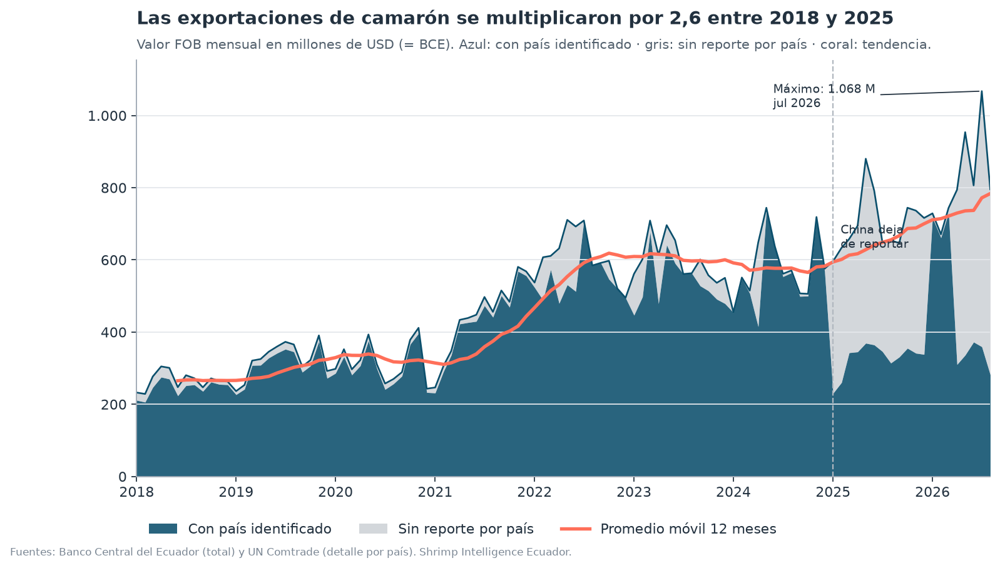
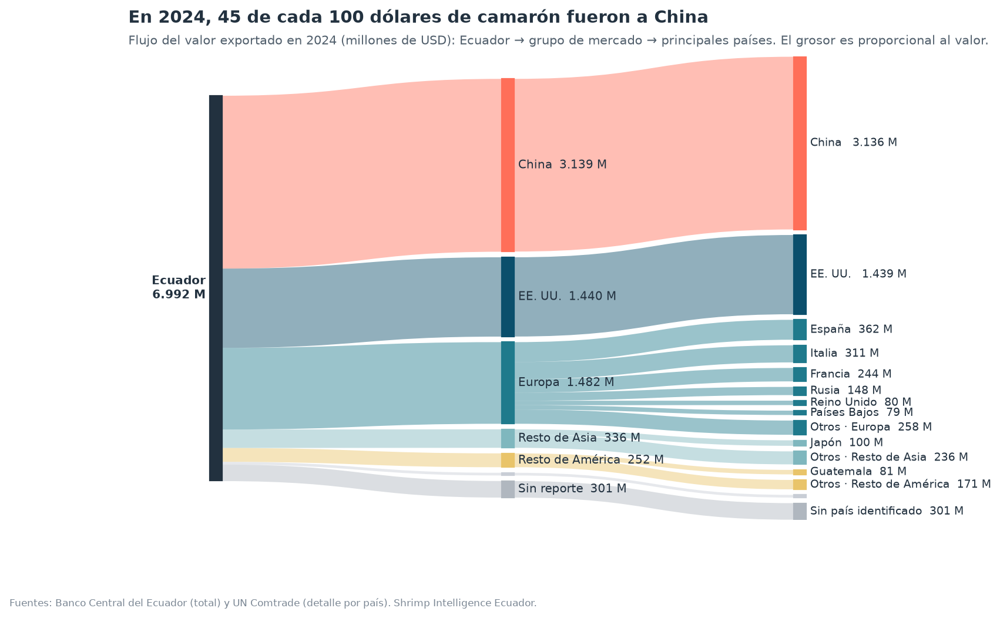
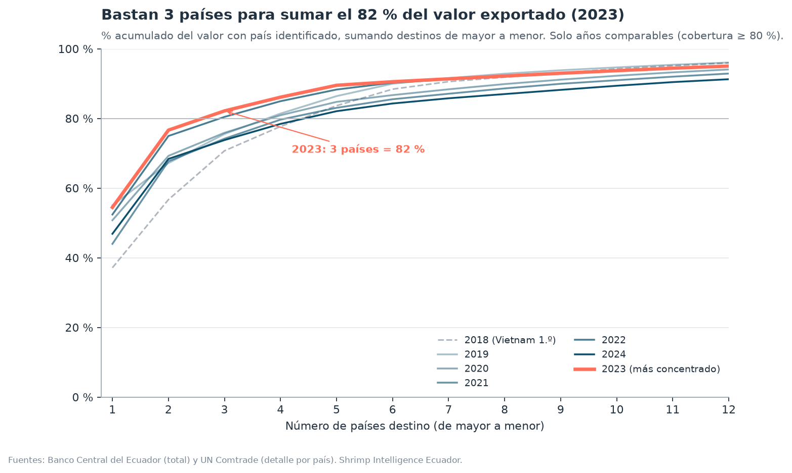
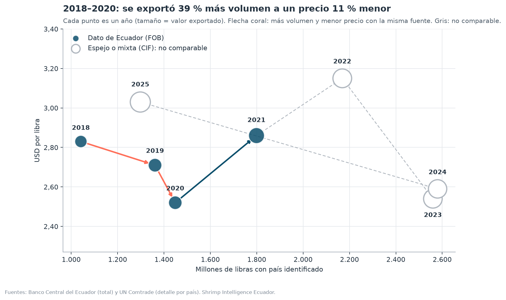
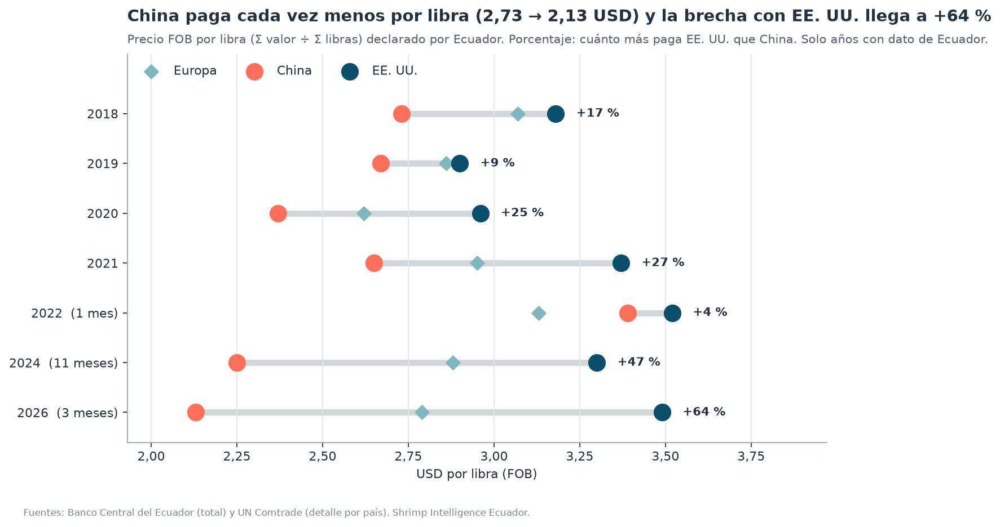
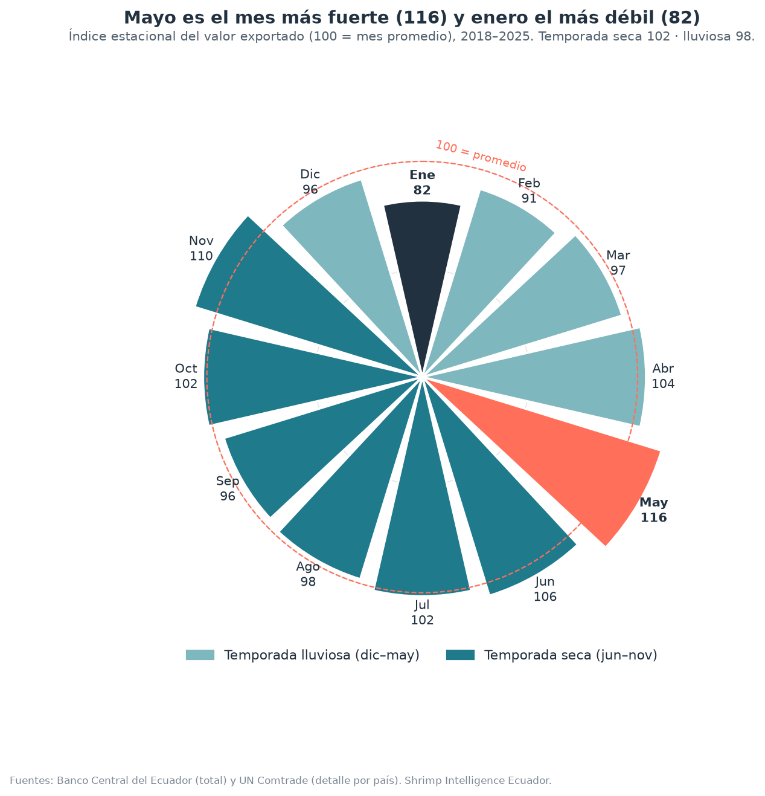
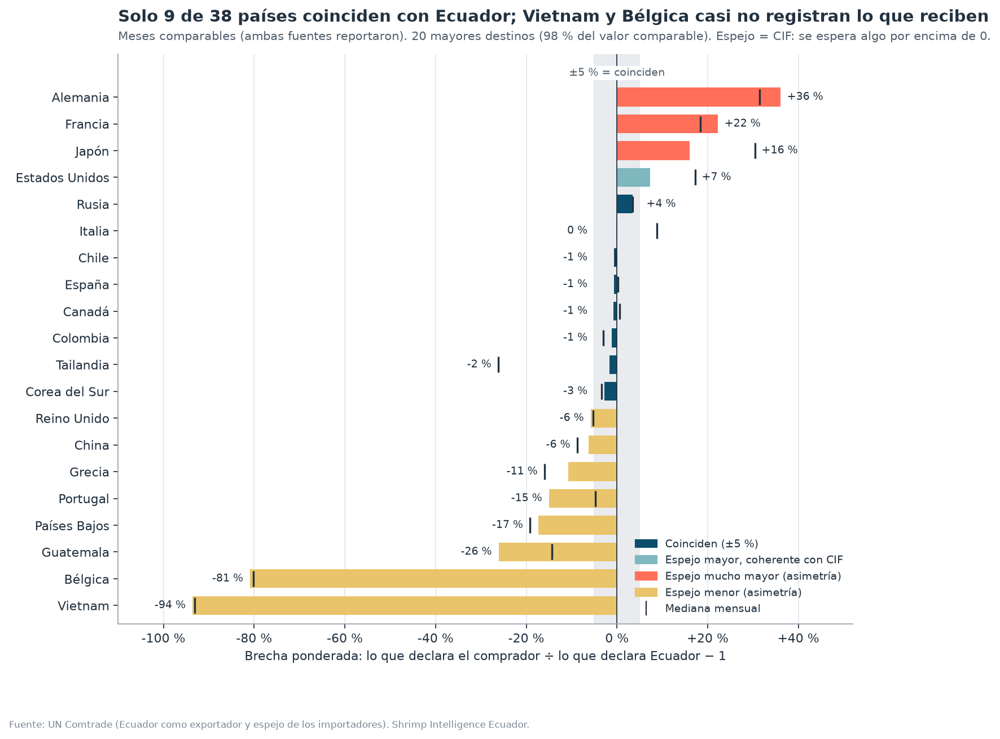
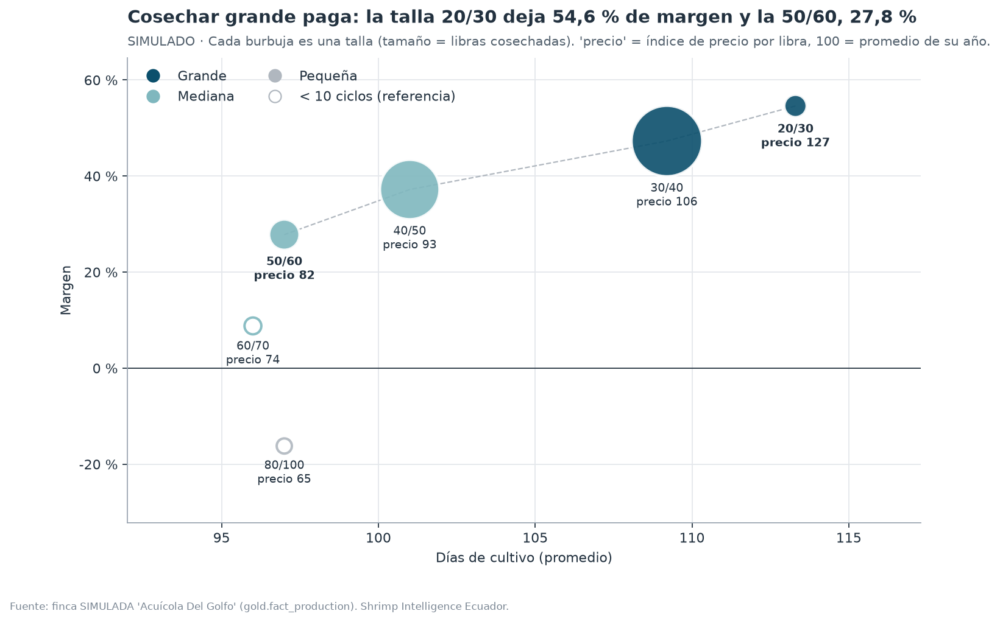
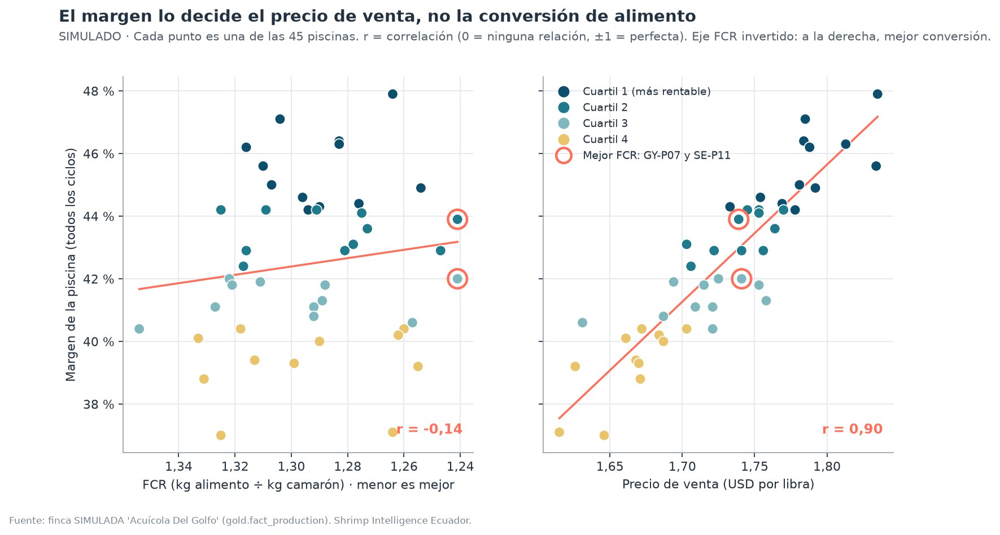

# Notebooks — Análisis exploratorio (Fase 10)

| Notebook | Qué contiene |
|---|---|
| `01_eda_exportaciones.ipynb` | 9 gráficos: concentración de mercados, precio y estacionalidad, calidad de fuentes y finca SIMULADA. Cada gráfico lleva la conclusión escrita debajo. |

## Cómo ejecutarlo

```powershell
cd D:\shrimp-intelligence-ecuador
.\.venv\Scripts\Activate.ps1
code notebooks\01_eda_exportaciones.ipynb     # en VS Code: kernel .venv → Run All
```

- Requiere MySQL encendido con gold cargado (`python -m src.pipeline`).
- Los datos salen de las mismas consultas de `sql/queries/` (función `load_query` de `src/eda_style.py`):
  una sola fuente de verdad para el notebook, la API y Power BI.
- Cada gráfico se guarda en `docs/img/` (160 dpi) para el README y LinkedIn.
- Paleta y estilo comunes en `src/eda_style.py`: azul océano = dato principal, coral = lo que hay que
  mirar, gris = "Sin reporte" o no comparable. La misma paleta se usará en Power BI.

## Los 9 gráficos

### 1. ¿Cuánto exporta Ecuador y a quién?

| # | Gráfico | Pregunta | Hallazgo | Consulta |
|---|---|---|---|---|
| 1 | Río (área) | ¿Cómo evolucionó el valor exportado y cuánto tiene país identificado? | El valor anual se multiplicó por 2,6 entre 2018 y 2025 (BCE); en 2025 la mitad no tiene país porque China no reportó. | gold (mensual) |
| 2 | Flujo (alluvial) | ¿Adónde va el camarón? | De cada 100 USD, unos 45 van a China (2024). | q01, q02 |
| 3 | Curva de concentración | ¿Qué tan concentrada está la demanda? | 3 países suman 74–82 % del valor en todos los años comparables; HHI > 2.500. | q03 + gold |





### 2. ¿Se vende más por menos?

| # | Gráfico | Pregunta | Hallazgo | Consulta |
|---|---|---|---|---|
| 4 | Scatter conectado | ¿Más volumen a menor precio? | 2018–2020: +39 % de volumen con precio −11 % (FOB). | q04 |
| 5 | Dumbbell | ¿Qué mercado paga más por libra? | China paga cada vez menos (2,73 → 2,13 USD/lb); la brecha con EE. UU. llega a +64 %. | q05 |
| 6 | Radial | ¿Hay estacionalidad? | Mayo es el mes más fuerte (116) y enero el más débil (82). | q06 |





### 3. ¿Qué tan confiables son las fuentes por país?

| # | Gráfico | Pregunta | Hallazgo | Consulta |
|---|---|---|---|---|
| 7 | Barras divergentes | ¿Coincide lo que declara el comprador con lo que declara Ecuador? | Solo 9 de 38 países coinciden (±5 %); Vietnam −94 % y Bélgica −81 % (hipótesis: puertas de entrada). | q12 |



### 4. La finca: ¿qué mueve el margen? (datos SIMULADOS)

| # | Gráfico | Pregunta | Hallazgo | Consulta |
|---|---|---|---|---|
| 8 | Burbujas | ¿Conviene cosechar más grande? | 20/30 deja 54,6 % de margen; 50/60, 27,8 %. | q09 |
| 9 | Dos scatter | ¿Qué explica el margen de cada piscina? | El precio de venta (r = 0,90), no el FCR (r = −0,14). | q07 + q08 |




> La finca "Acuícola Del Golfo" es **SIMULADA**: el método es real; las cifras no describen a ninguna empresa.

## Limitaciones

- 2022–2023 y 2025: el detalle por país viene del espejo (CIF); los precios de esos años no se comparan con
  los FOB (puntos grises en el gráfico 4).
- 2025–2026: "Sin reporte por país" supera el 50 % (China no reportó): no se usan para concentración.
- En la finca simulada el FCR y el costo por libra casi no varían; con datos reales conviene repetir el gráfico 9.
